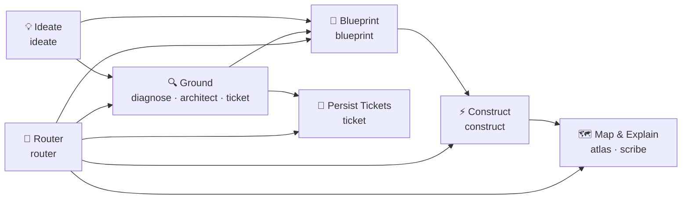

# Skills For People Like Me

[](https://github.com/akshay-diwadkar/first-four-hours/releases/latest)
[](LICENSE)
[](pyproject.toml)

> **Repository-grounded skills for AI coding agents to plan, implement, diagnose, improve, and reason with confidence.**

AI coding agents are powerful, but unbounded agents frequently hallucinate fixes, edit the wrong files, or jump straight into messy code modifications without understanding the repository. 

These skills provide a modular collection of specialized, self-contained packages designed to **raise the floor and preserve the ceiling**: giving your agent the structure to discover, reason, plan, and verify before editing a single line of code.

---

## ⚡ Why Use These Skills?

- 🔍 **Ground Decisions in Reality**: Workflows inspect current source, configuration, tests, and contracts before proposing changes.
- 📋 **Verifiable Artifacts**: Planning and diagnosis skills produce sealed, inspectable outputs (`blueprint.md`, `diagnosis.md`, `architecture.md`) before work moves forward.
- 🛡️ **Fail-Closed Workspace Safety**: Execution skills protect untouched work, derive exact repository deltas, and report mechanical verification.
- 🧠 **Deliberate Reasoning Recovery**: Dedicated reasoning interventions unblock stuck models, challenge weak assumptions, and ask the right questions.
- 🧩 **Modular & Composable**: Use one standalone skill for a quick task or chain them into an end-to-end software development lifecycle.

---

## 🚀 Quickstart

### 1. Install via Skills CLI

Install the complete suite with a single command:

```bash
npx skills add akshay-diwadkar/first-four-hours --skill '*'
```

Or install an individual skill (e.g., `blueprint`):

```bash
npx skills add akshay-diwadkar/first-four-hours --skill blueprint
```

Add `--global` to make skills available across all your projects.

### 2. Platform Compatibility

Certified agent names are `claude-code`, `codex`, and `github-copilot`. For example:

```bash
npx skills add akshay-diwadkar/first-four-hours --skill '*' --agent codex
```

---

## 🧰 The Skill Suite

The collection is organized into three explanatory domains. Choose a capability by task intent; domain classification is a useful mental model, not a prerequisite for selection.

Classify by primary ownership: capabilities primarily understanding, representing, planning, changing, or verifying repository/project state or its change lifecycle belong to Workbench; capabilities primarily improving decision readiness through reasoning, exploration, communication, or coordination belong to Sensemaking; capabilities primarily building a person's own knowledge and ability in any subject, technical or not, belong to Learning. Every active public skill needs exactly one domain before release/package convergence, once investigation and design provide enough evidence. If no definition fits, revisit the hierarchy explicitly rather than adding dual membership or another domain. The filesystem owns current membership, which changes through explicit capability addition or retirement. Every domain retains agent-owned semantic judgment and existing skill boundaries; domains organize the suite, not a pipeline, while Router routes concrete capabilities.

### Workbench — project-facing capabilities

| Skill | What it does |
| :--- | :--- |
| [`blueprint`](skills/workbench/blueprint/SKILL.md) | Plans decision-complete changes with explicit target states, cited sources, a minimum-sufficient rent rule, discriminating verification, a problem attack over input states, exit paths, output consumers, and load-bearing assumptions, selective in-planning Ideate with user-owned selection, a separate fresh-context challenger, baseline-probed verification gates, and a sealed `blueprint.md` a weak executor applies without engineering judgment. |
| [`construct`](skills/workbench/construct/SKILL.md) | Executes a sealed Blueprint through one intake call, ordered implementation that applies declared exact and frozen text mechanically, red/green and three-attempt instruction checks, stateless resume, bounded local repair with a directly runnable reverify, one final verification, one diff reconciliation, and an artifact-free completion report. |
| [`assess`](skills/workbench/assess/SKILL.md) | Assesses one exact proposed change against current authority and base truth for correctness, code quality, maintainability, and proportionate security, sealing a revision-bound `assessment.md` result that grants no approval or merge authority. |
| [`pr`](skills/workbench/pr/SKILL.md) | Writes a reviewer-oriented PR description from the branch diff and its issue or sealed Blueprint, checks its citations, recorded verification runs, and Mermaid diagram shape, and opens the PR only after explicit confirmation; it never merges. |
| [`diagnose`](skills/workbench/diagnose/SKILL.md) | Audits code to identify current defects, risks, and evidence-backed improvement opportunities into `diagnosis.md`. |
| [`architect`](skills/workbench/architect/SKILL.md) | Evaluates structural boundaries, discovers bounded no-target architecture opportunities when needed, and seals `architecture.md`. |
| [`ticket`](skills/workbench/ticket/SKILL.md) | Persists work items to GitHub or a local store, or selects one ready ticket and narrows it into a Blueprint handoff. |
| [`atlas`](skills/workbench/atlas/SKILL.md) | Provides filesystem-native Map/Landmark/Satellite project folder orientation and freshness checks. |

### Sensemaking — reasoning, exploration, communication, and coordination capabilities

| Skill | What it does |
| :--- | :--- |
| [`reason`](skills/sensemaking/reason/SKILL.md) | Consulted at judgment checkpoints (before committing to an approach, after a failure or direction change, and before presenting a result) to restore decision readiness, challenge consequential claims, or ask one irreducible user-owned question; mechanical work skips it. |
| [`ideate`](skills/sensemaking/ideate/SKILL.md) | Researches possibilities across alternatives, causal paths, and trade-offs for any goal and recommends a direction in an ignored `.first-four-hours/ideations/<slug>/ideation.md`; the user keeps final selection. |
| [`scribe`](skills/sensemaking/scribe/SKILL.md) | Authors or audits source-grounded runbooks, setup guides, error messages, and system documentation. |
| [`router`](skills/sensemaking/router/SKILL.md) | Authors the smallest sufficient route across capabilities into an ignored `.first-four-hours/routes/<slug>/route.md`, stopping where the next step depends on an unknown outcome. |

### Learning — building a person's knowledge and ability in any subject

| Skill | What it does |
| :--- | :--- |
| [`tutor`](skills/learning/tutor/SKILL.md) | Teaches any subject through a direct explanation, interactive tutoring that checks understanding, or continuing learning with a realistic study plan and self-contained HTML lesson records in a committable `.learning/<subject>/` folder; delivered content is never recorded as demonstrated understanding. |
| [`examiner`](skills/learning/examiner/SKILL.md) | Writes original practice papers for a specific written examination from its researched requirements, with a separate explained answer key, marking scheme, and source notes, and audits every question before delivery, saving each practice set as committable HTML under `.learning/<subject>/exams/`; optionally marks attempts, diagnoses evidence-backed gaps, and keeps the examination section of the subject's shared study plan. An inferred format is never presented as official. |

---

## 🔄 How the Skills Fit Together



---

## 🧭 Planner and Executor Workflow

`blueprint` and `construct` split one change into planning and execution. A capable planner can settle every decision so that a cheaper executor only applies the plan. Blueprint is also meant to help a planner with only executor-level ability produce a stronger plan than it would produce unaided. These are aims, not measured guarantees, and the same holds for comparable quality at lower total cost.

Install `blueprint` and `construct`, plus `ideate` and the `reason` skill it consults when planning may need solution exploration, or install the whole suite with the Quickstart command. Construct is self-contained.

### Roles

| Role | Who | Owns |
| :--- | :--- | :--- |
| Planner | The session that runs `/blueprint` | Engineering decisions, the plan, and its verification. |
| Challenger | A separate fresh-context subagent that Blueprint launches | Attacks the draft plan before sealing and advises only. It does not need to be more capable than the planner. |
| Ideate | Invoked by the planner only when needed | Viable directions and a recommendation. It never makes the final choice. |
| Executor | The session that runs `/construct` | Applies the sealed plan faithfully, repairs its own coding mistakes within the plan, and reports. |
| You | The user | Intent questions, the final Ideate selection, `Owner gate:` conditions, and every commit, PR, and merge. |

### One settled-plan run

1. **Ask for the plan.** `/blueprint : <outcome, constraints, what must not change>`. The planner asks only questions whose answers change the correct solution, such as the outcome, compatibility, tradeoffs, or scope. It decides files, seams, and tests itself.
2. **Choose when asked.** Ideate runs inside the planning run, not as a separate stage before it. The planner invokes it only when no viable solution is apparent or the evidence cannot rank materially different directions. Ideate writes an ignored `.first-four-hours/ideations/<slug>/ideation.md` that holds a recommendation, or the next experiment that would decide. A recommendation is never approval. You make the final selection, unless you already chose or delegated the choice. If the selection is still yours, an `experiment-first` result may come back to you for evidence or a choice, and a `research-limited` result blocks the plan and is reported to you.
3. **Fresh challenge.** Before sealing, the challenger reads the draft as a mediocre executor who follows it literally. It looks for open decisions, missed consumers, and proof that could pass a wrong result. The planner repairs every supported finding. If no separate subagent can run, Blueprint stops without sealing.
4. **Seal.** Blueprint seals `.first-four-hours/blueprints/<task-slug>/blueprint.md` next to the frozen `request.md` and reports the path. The seal proves only the plan's shape and its binding to the inspected files. Readiness is the planner's judgment, and nothing is implemented or verified yet. Read the plan's Goal summary before you continue.
5. **Execute.** In the executor session, run `/construct : Implement the sealed blueprint in .first-four-hours/blueprints/<task-slug>/blueprint.md.` Construct applies each instruction in order and proves every step that declares proof, with at most three attempts per step. It runs the plan's Verification and compares the final diff against the plan. It writes no state of its own, so a resume rereads progress from the worktree. It never consults Reason or Ideate to fill a planning gap, and it never edits the sealed plan.
6. **Read the report.**

| Construct result | Meaning | Next owner |
| :--- | :--- | :--- |
| Completion report | Every instruction is applied, verification passed, and the diff matches the plan. `Owner gate:` conditions are listed as pending. | You, or the named owner: review the result, settle the owner gates, then commit and open a PR. Construct never commits. |
| `verification-incomplete` | A gate that the plan declared environmental did not finish, for example at the validation budget deadline. | You: run Construct again when the environment is healthy. An incomplete gate is never a pass. |
| `plan-contradiction` | The plan is stale, wrong, or incomplete against the actual code. | The planner: run a new `/blueprint` over the original request and Construct's evidence, in a fresh task directory, then run a fresh `/construct`. |
| `protected-work-conflict` | Continuing would overwrite unrelated uncommitted work. | That work's owner resolves it, then runs a fresh `/construct`. |
| `safety-contradiction` | A safety constraint failed, or the baseline moved: HEAD moved, or verification changed the worktree or timed out. | You: restore a trusted state, then run a fresh `/construct`. |
| Stopped with evidence | A step failed its third attempt, the attempt count was lost, or a resume cannot verify earlier progress or launch its proof. | You: judge the diff. Then run a fresh `/construct` from a trustworthy worktree, or take the evidence back to `/blueprint` when the plan is at fault. |

Fix review findings the same way. When `/assess` or another review reports a supported finding, plan the fix with a new `/blueprint` and apply it with a fresh `/construct`, never with a direct edit, so the planner keeps every decision.

### Choosing models

Model choice depends on context. When plan quality matters most, use your strongest affordable model for planning. The executor can be cheaper because the plan already settles every decision. The challenger does not need to be stronger than the planner.

### What the tests prove

The repository proves the mechanics with deterministic fakes and no live models. `STEP_PLAN` in [test_verification_lifecycle.py](tests/skills/construct/test_verification_lifecycle.py) is a small sealed plan that Construct executes. It has a red-then-green regression, exact text, a specified step, and a break-the-code check, and it reaches the resume, attempt-limit, and contradiction stops. [test_blueprint_contract.py](tests/skills/blueprint/test_blueprint_contract.py) covers prepare, check, and seal. These results are mechanical evidence. They do not prove model quality or cost savings. To observe quality and cost yourself, run the same request through different planner and executor pairings by hand, each from the same base commit and with a fresh task workspace, and compare the outcomes and token use. This comparison is optional, it is outside repository validation, and it has no guaranteed result.

### Where handoffs live

A skill that hands work to another agent seals the handoff in its own fixed folder under `.first-four-hours/` at the repository root. Git ignores that folder through a worktree-local `.git/info/exclude` rule that the skill writes, and the skill stops if the folder is already tracked or if the folder or `.first-four-hours/` itself is a link or not a directory. Architect uses `.first-four-hours/architectures/<slug>/architecture.md`, Assess uses `.first-four-hours/assessments/<slug>/assessment.md`, Blueprint uses `.first-four-hours/blueprints/<task-slug>/`, Diagnose uses `.first-four-hours/diagnoses/<slug>/diagnosis.md`, Ideate uses `.first-four-hours/ideations/<slug>/ideation.md`, Router uses `.first-four-hours/routes/<slug>/route.md`, and Ticket uses `.first-four-hours/ticket-scopes/<slug>/ticket-scope.md`. Scribe keeps its support bundle in the same kind of ignored folder, `.first-four-hours/document-bundles/<slug>/document-bundle.json`. Deliverables are not handoffs: Scribe's `document.md` and Ticket's local work-item store stay committable, the Atlas wiki is committed, and the study plan, Tutor's HTML lesson records, and Examiner's HTML practice sets stay committable under `.learning/<subject>/` in the folder where the learning skill was invoked. Construct and Reason produce no artifact. Artifacts left in the old top-level folders are not read; re-create them with their skill.

---

## 💬 Real-World Prompts

Once installed, invoke skills naturally in your agent's chat:

- **Diagnose an issue:**
  ```text
  /diagnose : Find out why authentication tokens expire prematurely under high concurrency.
  ```
- **Plan a complex change:**
  ```text
  /blueprint : Plan migrating our SQLite database to PostgreSQL connection pooling.
  ```
- **Execute a plan:**
  ```text
  /construct : Implement the approved sealed blueprint in .first-four-hours/blueprints/<task>/blueprint.md.
  ```
- **Assess an exact proposed change:**
  ```text
  /assess : Assess this exact branch against its authoritative issue and current base before merge.
  ```
- **Unblock reasoning or challenge a proposal:**
  ```text
  /reason : Reconcile these conflicting caching assumptions, or challenge the backwards-compatibility claim in this API migration proposal.
  ```
- **Generate documentation or system maps:**
  ```text
  /scribe : Write a source-grounded deployment runbook from our docker-compose and script files.
  ```

---

## ⚙️ Invocation Modes

Each skill has an invocation mode, recorded in [`invocation-policy.json`](invocation-policy.json), that controls how AI coding environments activate it:

| Mode | Skills | Behavior |
| :--- | :--- | :--- |
| `both` | `blueprint`, `construct`, `architect`, `scribe`, `ideate`, `reason`, `assess`, `tutor`, `examiner` | May be triggered automatically by the model when appropriate or invoked explicitly with `/skill-name`. |
| `user-invoked` | `diagnose`, `ticket`, `pr` | Requires explicit user invocation (`/skill-name`). Never triggered implicitly. |
| `model-invoked` | `router`, `atlas` | Activated by the model for lightweight background assistance or routing. |

---

## 🛠️ Development & Validation

Run the required repository validation suite from the repository root, naming the
base your work is measured against:

```bash
python tools/validation/test_ownership.py run --base-ref <base> --format json
```

The supervised runner enforces at most three collected cases per skill, 12
shared cases, and 48 cases total. The complete repository suite must finish
within 120 seconds, including startup and cleanup. Testing and repairs proceed
automatically without approval. A full pass also satisfies changed-path verification:

```bash
python tools/validation/test_ownership.py run --all --format json
```

Incomplete verification never counts as passing. Test work stops at 110 seconds
to reserve cleanup and reporting time; dependency preparation is separate.

See [validation policy](REPO_VERSIONING.md#validation) for the pre-merge check
and bounded optional diagnostics.

To set up a development environment and make a change, start with [`CONTRIBUTING.md`](CONTRIBUTING.md).

Each skill's context-load budgets live in [`tools/validation/context-load-budgets.json`](tools/validation/context-load-budgets.json); `python tools/validation/measure_context_load.py --format json` reports each skill's measured tokens, limit, and headroom.

---

## 📦 Publishing a Release

Release history lives in [`CHANGELOG.md`](CHANGELOG.md). To prepare a release, follow [Release Metadata](REPO_VERSIONING.md#release-metadata) and the repository validation policy in [`REPO_VERSIONING.md`](REPO_VERSIONING.md) before tagging the release.

---

## 📄 License

Distributed under the [MIT License](LICENSE).
